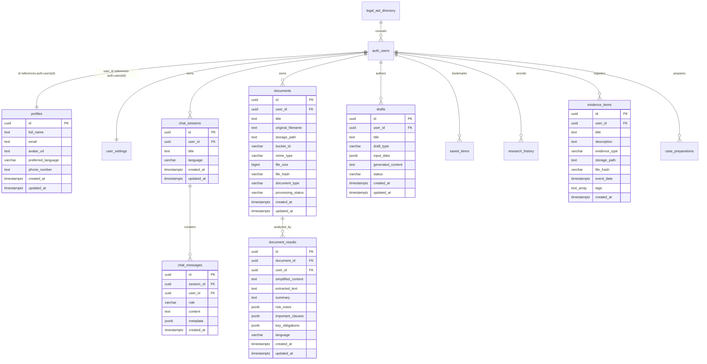

# Legal Helper Backend - Database Architecture & Schema Specification

This document details the PostgreSQL schema designed for the Legal Helper platform hosted on Supabase.

---

## 1. Entity-Relationship Overview

---

## 2. Table Specifications

### 2.1 `profiles`
Extends `auth.users` with application-level preferences and identity details.
* Primary Key: `id` (UUID references `auth.users(id)` ON DELETE CASCADE)
* Columns:
  * `id`: `UUID` (PK)
  * `full_name`: `TEXT`
  * `email`: `TEXT`
  * `avatar_url`: `TEXT`
  * `preferred_language`: `VARCHAR(10)` NOT NULL DEFAULT `'en'`
  * `phone_number`: `TEXT`
  * `created_at`: `TIMESTAMPTZ` NOT NULL DEFAULT `now()`
  * `updated_at`: `TIMESTAMPTZ` NOT NULL DEFAULT `now()`
* Triggers:
  * `handle_updated_at()`: updates `updated_at` on every change.
  * Triggered on user creation via `auth.users` insert hook `handle_new_user()`.

### 2.2 `chat_sessions`
Manages multi-turn conversations with the Legal AI Advisor.
* Primary Key: `id` (UUID DEFAULT `gen_random_uuid()`)
* Columns:
  * `id`: `UUID` (PK)
  * `user_id`: `UUID` NOT NULL REFERENCES `auth.users(id)` ON DELETE CASCADE
  * `title`: `TEXT` NOT NULL DEFAULT `'New Legal Consultation'`
  * `language`: `VARCHAR(10)` NOT NULL DEFAULT `'en'`
  * `created_at`: `TIMESTAMPTZ` NOT NULL DEFAULT `now()`
  * `updated_at`: `TIMESTAMPTZ` NOT NULL DEFAULT `now()`

### 2.3 `chat_messages`
Stores individual conversation messages within a consultation session.
* Primary Key: `id` (UUID DEFAULT `gen_random_uuid()`)
* Columns:
  * `id`: `UUID` (PK)
  * `session_id`: `UUID` NOT NULL REFERENCES `public.chat_sessions(id)` ON DELETE CASCADE
  * `user_id`: `UUID` NOT NULL REFERENCES `auth.users(id)` ON DELETE CASCADE
  * `role`: `VARCHAR(20)` NOT NULL CHECK (`role IN ('user', 'assistant', 'system')`)
  * `content`: `TEXT` NOT NULL
  * `metadata`: `JSONB` NOT NULL DEFAULT `'{}'` (provider, model, token usage, disclaimers)
  * `created_at`: `TIMESTAMPTZ` NOT NULL DEFAULT `now()`
* Triggers:
  * Automatically touches `chat_sessions.updated_at` whenever a new message is appended.

### 2.4 `documents`
Secure Legal Vault registry for contracts, notices, and pleadings.
* Primary Key: `id` (UUID DEFAULT `gen_random_uuid()`)
* Columns:
  * `id`: `UUID` (PK)
  * `user_id`: `UUID` NOT NULL REFERENCES `auth.users(id)` ON DELETE CASCADE
  * `title`: `TEXT` NOT NULL
  * `original_filename`: `TEXT` NOT NULL
  * `storage_path`: `TEXT` NOT NULL
  * `bucket_id`: `VARCHAR(50)` NOT NULL DEFAULT `'legal-documents'`
  * `mime_type`: `VARCHAR(100)` NOT NULL
  * `file_size`: `BIGINT` NOT NULL CHECK (`file_size > 0`)
  * `file_hash`: `VARCHAR(64)` (SHA-256 integrity hash)
  * `document_type`: `VARCHAR(50)` NOT NULL DEFAULT `'other'`
  * `processing_status`: `VARCHAR(20)` NOT NULL CHECK (`processing_status IN ('pending', 'processing', 'completed', 'failed')`) DEFAULT `'pending'`
  * `error_message`: `TEXT`
  * `created_at`: `TIMESTAMPTZ` NOT NULL DEFAULT `now()`
  * `updated_at`: `TIMESTAMPTZ` NOT NULL DEFAULT `now()`

### 2.5 `document_results`
Stores text extractions, plain-language simplifications, clause breakdowns, and risk audits.
* Primary Key: `id` (UUID DEFAULT `gen_random_uuid()`)
* Columns:
  * `id`: `UUID` (PK)
  * `document_id`: `UUID` NOT NULL REFERENCES `public.documents(id)` ON DELETE CASCADE
  * `user_id`: `UUID` NOT NULL REFERENCES `auth.users(id)` ON DELETE CASCADE
  * `simplified_content`: `TEXT`
  * `extracted_text`: `TEXT`
  * `summary`: `TEXT`
  * `risk_notes`: `JSONB` NOT NULL DEFAULT `'[]'`
  * `important_clauses`: `JSONB` NOT NULL DEFAULT `'[]'`
  * `key_obligations`: `JSONB` NOT NULL DEFAULT `'[]'`
  * `language`: `VARCHAR(10)` NOT NULL DEFAULT `'en'`
  * `metadata`: `JSONB` NOT NULL DEFAULT `'{}'`
  * `created_at`: `TIMESTAMPTZ` NOT NULL DEFAULT `now()`
  * `updated_at`: `TIMESTAMPTZ` NOT NULL DEFAULT `now()`
* Constraints:
  * `UNIQUE (document_id, language)`

### 2.6 `drafts`
Houses generated and user-edited legal notices, applications, and agreements.
* Primary Key: `id` (UUID DEFAULT `gen_random_uuid()`)
* Columns:
  * `id`: `UUID` (PK)
  * `user_id`: `UUID` NOT NULL REFERENCES `auth.users(id)` ON DELETE CASCADE
  * `title`: `TEXT` NOT NULL
  * `draft_type`: `VARCHAR(50)` NOT NULL
  * `input_data`: `JSONB` NOT NULL DEFAULT `'{}'`
  * `generated_content`: `TEXT` NOT NULL
  * `status`: `VARCHAR(20)` NOT NULL CHECK (`status IN ('draft', 'review_pending', 'finalized', 'archived')`) DEFAULT `'draft'`
  * `metadata`: `JSONB` NOT NULL DEFAULT `'{}'`
  * `created_at`: `TIMESTAMPTZ` NOT NULL DEFAULT `now()`
  * `updated_at`: `TIMESTAMPTZ` NOT NULL DEFAULT `now()`

### 2.7 `saved_items`
User bookmarks for quick access across documents, drafts, research, and consultations.
* Primary Key: `id` (UUID DEFAULT `gen_random_uuid()`)
* Columns:
  * `id`: `UUID` (PK)
  * `user_id`: `UUID` NOT NULL REFERENCES `auth.users(id)` ON DELETE CASCADE
  * `item_type`: `VARCHAR(50)` NOT NULL CHECK (`item_type IN ('document', 'draft', 'research', 'chat_session', 'legal_aid_resource', 'evidence', 'other')`)
  * `item_reference`: `TEXT` NOT NULL
  * `title`: `TEXT` NOT NULL
  * `description`: `TEXT`
  * `metadata`: `JSONB` NOT NULL DEFAULT `'{}'`
  * `created_at`: `TIMESTAMPTZ` NOT NULL DEFAULT `now()`
* Constraints:
  * `UNIQUE (user_id, item_type, item_reference)` prevents duplicate bookmarks.

### 2.8 `research_history`
Search query audit trail with statutory citations and verified judgments.
* Primary Key: `id` (UUID DEFAULT `gen_random_uuid()`)
* Columns:
  * `id`: `UUID` (PK)
  * `user_id`: `UUID` NOT NULL REFERENCES `auth.users(id)` ON DELETE CASCADE
  * `query`: `TEXT` NOT NULL
  * `jurisdiction`: `VARCHAR(50)` NOT NULL DEFAULT `'IN'`
  * `summary`: `TEXT`
  * `results`: `JSONB` NOT NULL DEFAULT `'[]'`
  * `sources`: `JSONB` NOT NULL DEFAULT `'[]'`
  * `metadata`: `JSONB` NOT NULL DEFAULT `'{}'`
  * `created_at`: `TIMESTAMPTZ` NOT NULL DEFAULT `now()`
  * `updated_at`: `TIMESTAMPTZ` NOT NULL DEFAULT `now()`

### 2.9 `evidence_items`
Registry of evidentiary artifacts with timestamp tracking and SHA-256 data integrity hashes.
* Primary Key: `id` (UUID DEFAULT `gen_random_uuid()`)
* Columns:
  * `id`: `UUID` (PK)
  * `user_id`: `UUID` NOT NULL REFERENCES `auth.users(id)` ON DELETE CASCADE
  * `title`: `TEXT` NOT NULL
  * `description`: `TEXT`
  * `evidence_type`: `VARCHAR(50)` NOT NULL CHECK (`evidence_type IN ('document', 'image', 'audio', 'video', 'message_screenshot', 'receipt', 'email', 'bank_statement', 'contract', 'other')`)
  * `storage_path`: `TEXT`
  * `bucket_id`: `VARCHAR(50)` NOT NULL DEFAULT `'evidence-files'`
  * `file_hash`: `VARCHAR(64)` (SHA-256)
  * `mime_type`: `VARCHAR(100)`
  * `file_size`: `BIGINT`
  * `event_date`: `TIMESTAMPTZ` NOT NULL (Date of occurrence)
  * `tags`: `TEXT[]` NOT NULL DEFAULT `'{}'`
  * `metadata`: `JSONB` NOT NULL DEFAULT `'{}'`
  * `created_at`: `TIMESTAMPTZ` NOT NULL DEFAULT `now()`
  * `updated_at`: `TIMESTAMPTZ` NOT NULL DEFAULT `now()`

### 2.10 `case_preparations`
Structured consultation dossiers for advocates.
* Primary Key: `id` (UUID DEFAULT `gen_random_uuid()`)
* Columns:
  * `id`: `UUID` (PK)
  * `user_id`: `UUID` NOT NULL REFERENCES `auth.users(id)` ON DELETE CASCADE
  * `title`: `TEXT` NOT NULL
  * `case_type`: `VARCHAR(100)` NOT NULL
  * `facts_summary`: `TEXT` NOT NULL
  * `timeline_events`: `JSONB` NOT NULL DEFAULT `'[]'`
  * `questions_for_lawyer`: `JSONB` NOT NULL DEFAULT `'[]'`
  * `checklist`: `JSONB` NOT NULL DEFAULT `'[]'`
  * `notes`: `TEXT`
  * `metadata`: `JSONB` NOT NULL DEFAULT `'{}'`
  * `created_at`: `TIMESTAMPTZ` NOT NULL DEFAULT `now()`
  * `updated_at`: `TIMESTAMPTZ` NOT NULL DEFAULT `now()`

### 2.11 `legal_aid_directory`
Verified directory of government legal aid institutions under Legal Services Authorities Act, 1987.
* Read-accessible by all authenticated users.
* Columns: `id`, `organization_name`, `authority_level`, `jurisdiction_state`, `district`, `eligibility_criteria`, `contact_phone`, `helpline_number`, `contact_email`, `website_url`, `address`, `services_offered`, `is_active`, `created_at`, `updated_at`.

### 2.12 `user_settings`
User-level configuration for application UI, themes, notifications, and AI legal disclaimer consent.
* Primary Key: `id` (UUID DEFAULT `gen_random_uuid()`)
* Columns:
  * `id`: `UUID` (PK)
  * `user_id`: `UUID` UNIQUE NOT NULL REFERENCES `auth.users(id)` ON DELETE CASCADE
  * `preferred_language`: `VARCHAR(10)` NOT NULL DEFAULT `'en'`
  * `theme_mode`: `VARCHAR(20)` NOT NULL CHECK (`theme_mode IN ('light', 'dark', 'system')`) DEFAULT `'system'`
  * `notifications_enabled`: `BOOLEAN` NOT NULL DEFAULT `true`
  * `email_notifications`: `BOOLEAN` NOT NULL DEFAULT `false`
  * `ai_disclaimer_acknowledged`: `BOOLEAN` NOT NULL DEFAULT `false`
  * `disclaimer_acknowledged_at`: `TIMESTAMPTZ`
  * `created_at`: `TIMESTAMPTZ` NOT NULL DEFAULT `now()`
  * `updated_at`: `TIMESTAMPTZ` NOT NULL DEFAULT `now()`
* Auto-seeded on user signup via `handle_new_user_settings()` hook.

---

## 3. Database Triggers & Automations

| Trigger Name | Target Table | Timing & Event | Function | Description |
| :--- | :--- | :--- | :--- | :--- |
| `on_auth_user_created` | `auth.users` | `AFTER INSERT` | `handle_new_user()` | Automatically inserts `public.profiles` row with metadata |
| `on_auth_user_created_settings` | `auth.users` | `AFTER INSERT` | `handle_new_user_settings()` | Automatically seeds default `public.user_settings` row |
| `on_chat_message_inserted` | `public.chat_messages` | `AFTER INSERT` | `handle_new_chat_message()` | Touches `chat_sessions.updated_at` on message creation |
| `set_*_updated_at` | All tables | `BEFORE UPDATE` | `handle_updated_at()` | Automatically updates timestamp to current UTC time |

---

## 4. Performance Indexes

### Foreign Key & Retrieval Indexes
* `idx_chat_sessions_user_id`: `(user_id, updated_at DESC)`
* `idx_chat_messages_session_id`: `(session_id, created_at ASC)`
* `idx_documents_user_id`: `(user_id, created_at DESC)`
* `idx_documents_file_hash`: `(file_hash)`
* `idx_document_results_doc_id`: `(document_id)`
* `idx_drafts_user_id`: `(user_id, updated_at DESC)`
* `idx_saved_items_user_type`: `(user_id, item_type)`
* `idx_research_history_user`: `(user_id, created_at DESC)`
* `idx_evidence_items_user_date`: `(user_id, event_date DESC)`
* `idx_case_prep_user`: `(user_id, created_at DESC)`
* `idx_legal_aid_state`: `(jurisdiction_state, authority_level)`

### Full-Text Search (GIN) Indexes
* `idx_documents_fts`: `USING GIN (to_tsvector('english', title || ' ' || original_filename))`
* `idx_drafts_fts`: `USING GIN (to_tsvector('english', title || ' ' || generated_content))`
* `idx_research_fts`: `USING GIN (to_tsvector('english', query || ' ' || COALESCE(summary, '')))`
* `idx_evidence_fts`: `USING GIN (to_tsvector('english', title || ' ' || COALESCE(description, '')))`

